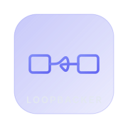
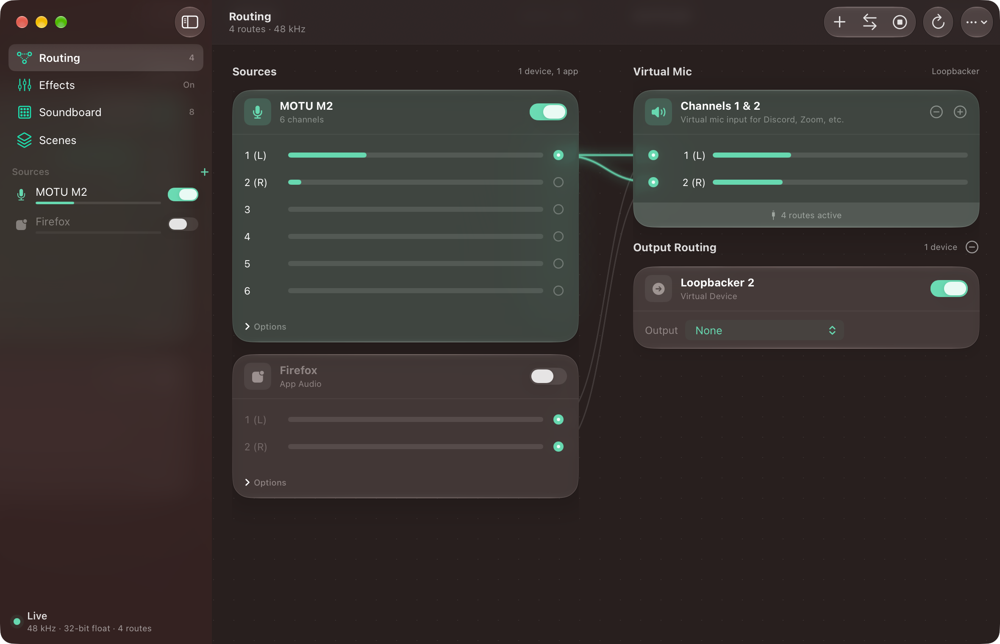
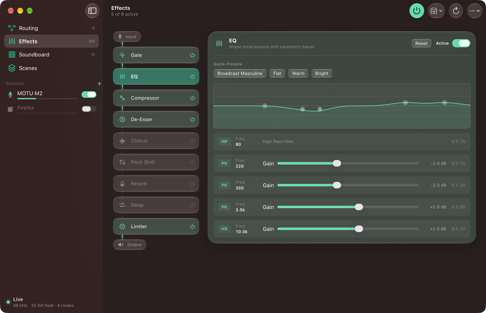
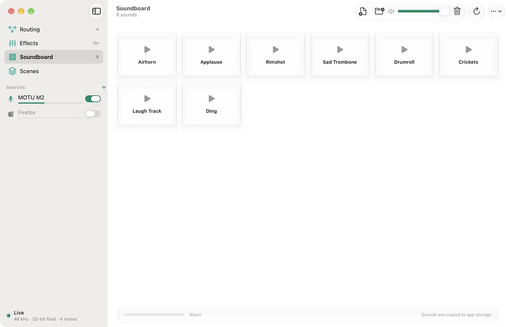
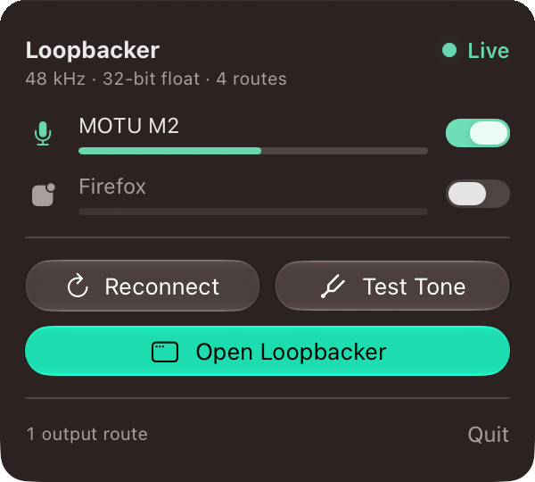

<p align="center">
  <picture>
    <source media="(prefers-color-scheme: dark)" srcset="docs/assets/logo-dark.svg">
    <source media="(prefers-color-scheme: light)" srcset="docs/assets/logo-light.svg">
    
  </picture>
</p>

<h1 align="center">Loopbacker</h1>

<p align="center">
  Virtual audio loopback + broadcast voice processing for macOS.
</p>

<p align="center">
  <a href="https://github.com/JacobCoffee/loopbacker/actions/workflows/ci.yml"></a>
  <a href="https://github.com/JacobCoffee/loopbacker/releases"></a>
  
  <a href="LICENSE"></a>
</p>

---

<p align="center">
  <picture>
    <source media="(prefers-color-scheme: dark)" srcset="docs/screenshots/routing-dark.png">
    <source media="(prefers-color-scheme: light)" srcset="docs/screenshots/routing-light.png">
    
  </picture>
</p>

Loopbacker creates a virtual audio device on macOS that captures audio from any app and makes it available as a mic input. Route desktop audio into Discord, OBS, Zoom, or any recording app. It also has a full audio effects chain for broadcast voice processing, and a soundboard for playing audio clips through the virtual device.

## Features

**Audio Routing**

- Virtual loopback devices (48kHz / 32-bit float), 2–16 channels per device
- Route any channel of any input device to any virtual mic channel; add mic channels in pairs with ⊕
- Monitor output (hear yourself through speakers)
- Per-channel routing with visual cable connections
- 2 independent virtual loopback devices
- Output routing: send one channel pair of a multichannel device to your speakers while apps record the other channels
- Scenes system for saving/loading routing configs
- Open at Login: starts in the menu bar with routing live, no window (menu bar panel or **More** menu)

**Noise Suppression**

- On-device noise removal for mic inputs, run inline on the audio thread, with three engines:
  - [CEVA's DPDFNet2](https://github.com/ceva-ip/DPDFNet) 48 kHz neural model through BNNS Graph: strongest cleanup (fans, keyboards, chatter), 60 ms of latency
  - [aask1357's FastEnhancer-S](https://github.com/aask1357/fastenhancer) 48 kHz neural model, also through BNNS Graph: close to DPDFNet's cleanup, 21 ms of latency, a fraction of DPDFNet's CPU
  - [Xiph's RNNoise](https://github.com/xiph/rnnoise): lighter cleanup (steady hiss and hum), 30 ms of latency, about a third of DPDFNet's CPU
- The Effects section compares them with CPU measured on your Mac and recommends one; switching frees the other engine's memory
- Runs before the effects chain, independent of its bypass and presets; toggle it from the Effects section or the menu bar
- Per-mic opt-out in each source's Options
- Max Reduction control (-60 to -6 dB) to keep some room tone instead of dead silence
- Latency is constant at any buffer size
- Applies to mic → virtual mic and monitor routes, not app captures

**Effects Chain** (9 real-time DSP effects, all processed on the audio thread)

- Noise Gate -- soft expander with configurable threshold
- 5-band Parametric EQ -- draggable frequency response curve, highpass/peaking/shelf filters
- Compressor -- linked stereo detection, adjustable ratio/threshold/makeup
- De-Esser -- bandpass sidechain targeting 4-8kHz sibilance
- Chorus -- modulated delay line with stereo LFO
- Pitch Shift -- -12 to +12 semitones, dual-head overlap-add
- Reverb -- Freeverb algorithm (8 comb filters + 4 allpass diffusers)
- Delay -- echo with feedback + soft-clip safety
- Limiter -- brick-wall peak limiter, always last in chain

12 factory presets: Broadcast Masculine Voice, Podcast Clean, Radio Announcer, Chipmunk, Deep Voice, Robot, Telephone, Cathedral, Dreamy, Space Station, and more. Save your own presets, import/export as JSON to share with others.

The EQ settings match [jtrv's EasyEffects Masculine NPR Voice preset](https://gist.github.com/jtrv/47542c8be6345951802eebcf9dc7da31) -- the same signal chain used by podcasters and streamers on Linux, ported to native macOS with zero dependencies.

<p align="center">
  
</p>

**Soundboard**

- Play audio files (MP3, WAV, M4A, AIFF, FLAC, CAF) through the virtual device
- Add individual files or scan an entire folder
- Drag and drop audio files onto the grid
- Multiple simultaneous sounds (CoreAudio mixes them on the device)
- Global volume control
- Sounds appear in Discord/Zoom/OBS as if they're your mic

<p align="center">
  
</p>

**UI**

- macOS 26 Liquid Glass design, light and dark, with an in-app appearance override
- Sidebar with Routing, Effects, Soundboard, and Scenes (⌘1–⌘4), plus every source's live level and on/off switch
- Routing canvas where cables glow with the signal running through them
- Effects shown as a vertical insert chain, like a channel strip
- Menu bar panel with live meters, per-source switches, Reconnect, and Test Tone
- Audio menu with keyboard shortcuts: Reconnect (⌘R), Stop All Routing (⇧⌘.), Test Tone (⌥⌘T)
- Background auto-update (Sparkle, EdDSA-signed): checks silently, never pops a window in front
  of you -- "Update available" shows in the menu bar panel and the app menu, and installs on your
  click or on quit. Driver updates are offered the same way but always need your click, since
  installing one needs admin and briefly drops audio

<p align="center">
  
</p>

## How it works

```
Mic / App Output                        Discord / OBS / Zoom
       |                                       ^
       | capture                               | reads as mic input
   [ Noise Suppression ]  (mic inputs)         |
   [ Effects Chain ]                           |
   Gate > EQ > Comp > DeEss >                 |
   Chorus > Pitch > Reverb > Delay > Limiter  |
       |                                       |
       v                                       |
   +---+---------------------------------------+---+
   |              Lock-free Ring Buffer             |
   +------------------------------------------------+
                  Loopbacker Virtual Device
```

A CoreAudio HAL plugin provides the virtual device. The SwiftUI app handles routing, effects processing, and driver installation. The effects chain and noise suppression run on the real-time audio thread with no allocations or locks; the noise model executes through BNNS Graph with preallocated, wired buffers.

## Install

### From source

Requires Xcode command-line tools and CMake (`brew install cmake`).

```bash
make all          # Build driver + app
make install      # Install driver (sudo) + app to /Applications
```

### From release

Download from [Releases](https://github.com/JacobCoffee/loopbacker/releases).

## Uninstall

```bash
make uninstall    # Remove driver + app
```

## Usage

1. Open **Loopbacker.app** and click **Install Driver** at the bottom of the sidebar (requires admin).
2. Add your microphone as a source with **+** in the toolbar or next to **Sources** in the sidebar.
3. In **Routing**, click a source channel's port, then an output channel's port, to connect them.
4. In your chat/recording app, select **Loopbacker** as the input device.
5. Open **Effects** (⌘2) to enable broadcast voice processing.
6. Open **Soundboard** (⌘3) to play audio clips through the virtual device, or **Scenes** (⌘4) to save and switch setups.

### Multichannel example: timecode alongside monitoring

1. In **Routing → Output Routing**, add **Loopbacker 2**, set **Channels** to 4, **Monitor** to 1–2, and **Output** to your speakers.
2. In DaVinci Resolve (or any app), output to **Loopbacker 2** and put the timecode on channel 3.
3. Point your timecode-to-MIDI tool at **Loopbacker 2**, channel 3. You hear channels 1–2; channel 3 never reaches the speakers.

## Project structure

```
loopbacker/
├── Driver/          CoreAudio HAL plugin (C++17, CMake)
│   └── src/         Lock-free ring buffer, driver vtable, device management
├── App/             SwiftUI companion app (Swift 6 language mode, macOS 26)
│   ├── CRNNoise/    Vendored RNNoise (C)
│   └── Sources/
│       ├── Models/      AudioSource, AudioRoute, EffectsPreset, SoundboardItem
│       ├── Services/    AudioRouter, AudioEffectsChain, NoiseSuppressor, SoundboardPlayer
│       └── Views/       ContentView, EffectsView, SoundboardView, ...
├── scripts/         Install/uninstall helpers, model conversion, denoiser quality eval
└── docs/            Architecture docs
```

## Requirements

- macOS 26+ (Tahoe or later)
- Apple silicon (Intel Macs aren't supported)
- CMake 3.20+

## License

[FSL-1.1-MIT](LICENSE) -- free to use for any non-competing purpose, converts to MIT after 2 years.

The bundled noise suppression models are converted from upstream sources: `DPDFNet2_48k.mlmodelc` from [CEVA's DPDFNet](https://github.com/ceva-ip/DPDFNet) ([Apache-2.0](App/Loopbacker/Resources/DPDFNet-LICENSE.txt), `scripts/convert-dpdfnet.py`) and `FastEnhancer_S_48k.mlmodelc` from [aask1357's FastEnhancer](https://github.com/aask1357/fastenhancer) ([MIT](App/Loopbacker/Resources/FastEnhancer-LICENSE.txt), `scripts/convert-fastenhancer.py`); both need [uv](https://docs.astral.sh/uv/) to rebuild.

[RNNoise](https://github.com/xiph/rnnoise) (v0.2, default model) is vendored in `App/Loopbacker/CRNNoise` under the [BSD-3-Clause license](App/Loopbacker/Resources/RNNoise-LICENSE.txt).
